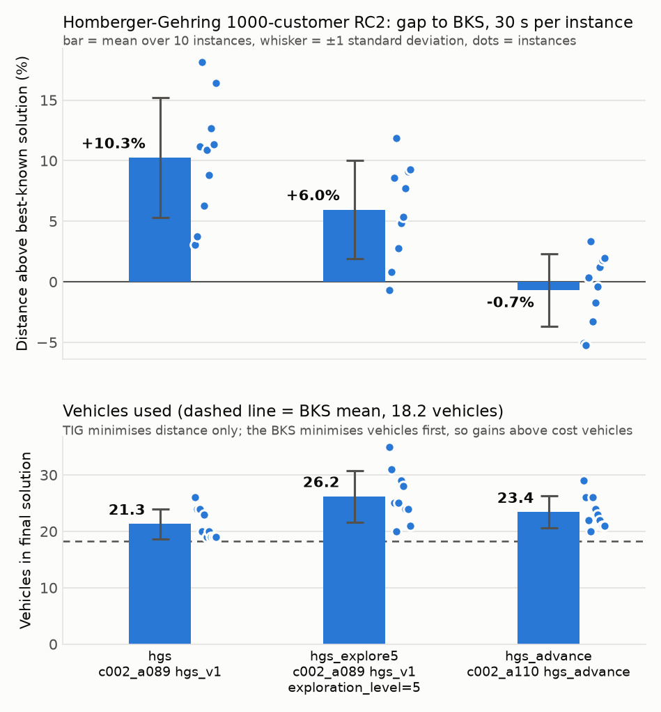

# Vehicle routing: TIG algorithms vs best-known solutions on Homberger-Gehring RC2

This folder is a self-contained experiment that benchmarks official TIG
vehicle-routing (`c002`, VRPTW) algorithms on the ten RC2 instances of the
Homberger-Gehring 1000-customer benchmark and reports how far each final
solution is from the published best-known solution (BKS).

RC2 was chosen because it is the hardest class in the sets surveyed: a long
scheduling horizon, wide time windows and only about 18 vehicles, so every
route carries 50 or more customers.

## Setup

| Item | Value |
| --- | --- |
| Instances | `RC2_10_1` to `RC2_10_10` from the SINTEF archive (`config.json` lists the URL and its SHA-256) |
| Import | `tig.py import --format solomon-vrptw` |
| Algorithms | `hgs` = `c002_a089` (`hgs_v1`) as shipped; `hgs_explore5` = the same algorithm with `{"exploration_level": 5}`; `hgs_advance` = `c002_a110` as shipped |
| Budget | 30 s solver time per instance (`--timeout 30`), one worker, one repetition, algorithm seed `default_seed` |
| Monorepo | `cd6090b8439ecd5b0f937c8d7bf3c35a46ff6dcb` (the kit's pinned commit at the time of the run) |
| BKS | `bks.json`, copied from the SINTEF best-known table on 2026-10-29 |

`hgs_explore5` is included because `hgs_v1`'s default preset is exploration
level 0, a single local search that finishes in about 0.3 s and therefore
ignores the 30 s budget. Level 5 is the author's deepest preset.

## Metric

For every instance the final saved solution is decoded, its routes are
re-measured with real-valued Euclidean distances from the instance
coordinates, and the gap is

```
gap % = (solution distance - BKS distance) / BKS distance * 100
```

Lower is better. The chart's top panel shows the mean gap over the ten
instances, a whisker of plus or minus one sample standard deviation, and one
dot per instance. The bottom panel shows the number of vehicles in each final
solution the same way, with the mean BKS fleet as a dashed line, so it is
visible at a glance that a negative gap is reached with a larger fleet.

Two caveats apply when reading the numbers against the literature:

- TIG rounds distances to integers and uses them as travel times, so a TIG
  solution can be slightly infeasible under real-valued time windows. The
  effect is small on RC2 because its windows are wide.
- TIG minimises distance only, subject to the fleet cap in the file (250
  vehicles here). The BKS minimises vehicles first. Negative gaps are
  obtained with more vehicles than the BKS uses; the table lists both.

## Results



| Instance | BKS vehicles | BKS distance | hgs gap | hgs vehicles | hgs_explore5 gap | hgs_explore5 vehicles | hgs_advance gap | hgs_advance vehicles |
|---|---|---|---|---|---|---|---|---|
| rc2_10_1 | 20 | 30276.27 | +3.08% | 26 | -0.70%* | 35 | -5.04% | 29 |
| rc2_10_2 | 18 | 26104.09 | +3.74% | 24 | +0.82%* | 31 | -5.22%* | 26 |
| rc2_10_3 | 18 | 19911.48 | +11.19% | 24 | +8.56%* | 25 | +0.35%* | 22 |
| rc2_10_4 | 18 | 15693.28 | +18.12% | 20 | +11.89%* | 20 | +3.32%* | 20 |
| rc2_10_5 | 18 | 27067.04 | +6.29% | 23 | +2.78%* | 25 | -3.30%* | 26 |
| rc2_10_6 | 18 | 26741.27 | +10.90% | 19 | +4.81%* | 29 | -1.71%* | 24 |
| rc2_10_7 | 18 | 24999.66 | +8.81% | 20 | +5.36%* | 28 | -0.40% | 23 |
| rc2_10_8 | 18 | 23595.33 | +12.67% | 19 | +7.73%* | 24 | +1.19%* | 22 |
| rc2_10_9 | 18 | 22919.42 | +11.35% | 19 | +9.07%* | 24 | +1.80%* | 21 |
| rc2_10_10 | 18 | 21834.94 | +16.40% | 19 | +9.29%* | 21 | +1.97%* | 21 |
| **mean ± sd** | **18.2** | | **+10.26% ± 4.94** | **21.3 ± 2.7** | **+5.96% ± 4.06** | **26.2 ± 4.6** | **-0.70% ± 3.01** | **23.4 ± 2.8** |

`*` marks runs that were stopped by the 30 s timeout; the last solution saved
before the stop is the one measured. Every configuration uses more vehicles
than the BKS on every instance, which is how `hgs_advance` lands below the
BKS distance on five instances. Mean solver time was 0.3 s for `hgs`,
30 s for `hgs_explore5` and 29.4 s for `hgs_advance` (it stopped on its own
criteria on two instances).

`results/per_instance.csv` has every row, including TIG's integer objective
and the run status, and `results/summary.json` has the aggregates.

## Reproducing

From the repository root, with Rust and `cargo` installed:

```bash
python3 -m pip install -r tig-stats-sota/vehicle-routing/requirements.txt   # matplotlib, chart only
python3 tig-stats-sota/vehicle-routing/run_experiment.py
```

`run_experiment.py` downloads the archive into `data/`, extracts and imports
the ten instances, runs each configuration from `config.json` into
`runs/<label>/`, then calls `analyze.py`, which writes `results/`. Steps whose
output already exists are skipped; use `--force-run` to solve again,
`--only <label>` to run one configuration, and `python3 analyze.py` on its own
to rebuild the tables and chart. `data/` and `runs/` are ignored by Git; only
`results/` is committed.

A full run takes about 15 minutes on one core, most of it the 30 s budgets.
Solver time is wall-clock per instance, so results depend on the machine.
