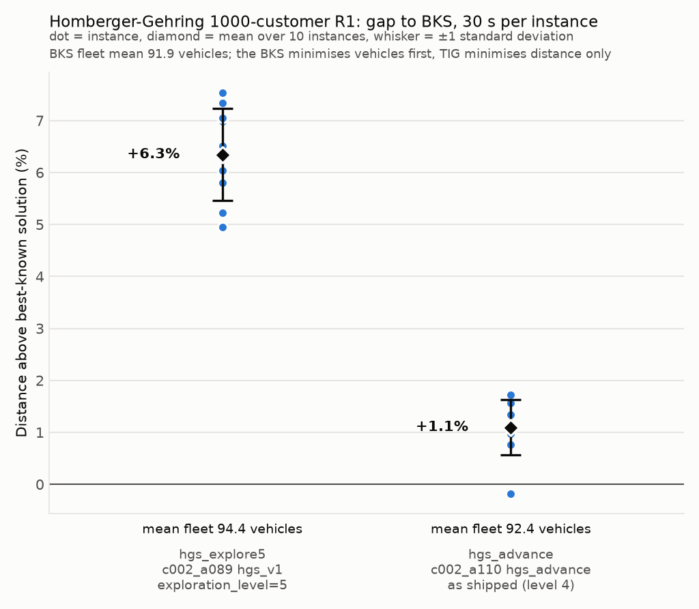

# Homberger-Gehring 1000-customer R1

Uniformly random customers, a short scheduling horizon, tight time windows
and vehicle capacity 200: the best-known solutions use 91 to 100 vehicles
with about 10 customers per route, so the fleet is fixed by the constraints
rather than by the objective. Ten instances, `R1_10_1` to `R1_10_10`, from
the SINTEF 1000-customer archive; the best-known values in `bks.json` are
from the SINTEF 1000-customer table, retrieved 2026-10-30.

The algorithms, budget, metric and caveats are shared across sets and
described in [the experiment README](../README.md).

## Results

| Instance | BKS vehicles | BKS distance | hgs_explore5 gap | hgs_explore5 vehicles | hgs_advance gap | hgs_advance vehicles |
|---|---|---|---|---|---|---|
| r1_10_1 | 100 | 53380.18 | +4.94%*† | 97 | -0.18%† | 94 |
| r1_10_2 | 91 | 48232.67 | +6.01%*† | 97 | +1.29%*† | 93 |
| r1_10_3 | 91 | 44689.19 | +7.54%*† | 94 | +1.38%*† | 92 |
| r1_10_4 | 91 | 42463.74 | +5.80%*† | 93 | +0.76%† | 92 |
| r1_10_5 | 91 | 50442.31 | +6.52%*† | 96 | +0.95%† | 93 |
| r1_10_6 | 91 | 46928.44 | +6.98%*† | 93 | +1.16%† | 92 |
| r1_10_7 | 91 | 43969.48 | +6.04%*† | 93 | +1.56%† | 92 |
| r1_10_8 | 91 | 42288.04 | +5.23%* | 93 | +0.97% | 92 |
| r1_10_9 | 91 | 49186.22 | +7.05%* | 94 | +1.35%† | 92 |
| r1_10_10 | 91 | 47403.83 | +7.33%*† | 94 | +1.73% | 92 |
| **mean ± sd** | **91.9** | | **+6.34% ± 0.88** | **94.4 ± 1.6** | **+1.10% ± 0.53** | **92.4 ± 0.7** |

`*` = stopped by the 30 s timeout; the last solution saved before the stop is the one
measured. `†` = at least one arrival after a due time under real-valued travel times
(`late_arrivals` and `max_lateness` in `results/per_instance.csv`).

This is the set where TIG's distance-only objective and the literature's
vehicles-first objective nearly coincide: `hgs_advance` uses one to three
vehicles more than the BKS on nine instances, and the gap is a plain distance
gap of about 1% with the smallest spread of the four sets. `hgs_explore5` ran
to the timeout on every instance; `hgs_advance` stopped on its own criteria
on eight (mean solver time 28.2 s).

On `r1_10_1` `hgs_advance` is below the BKS distance with 94 vehicles against
the best-known 100, but the `†` applies: under real-valued travel times it
arrives late at 19 customers, by under a time unit each, so it is not a new
best-known solution. Eight
solutions of each configuration have such late arrivals, by at most 1.0 time
unit on a horizon of 1925; with windows this tight it is the set where that
caveat matters most.

`results/per_instance.csv` has every row, including TIG's integer objective
and the run status, and `results/summary.json` has the aggregates.
