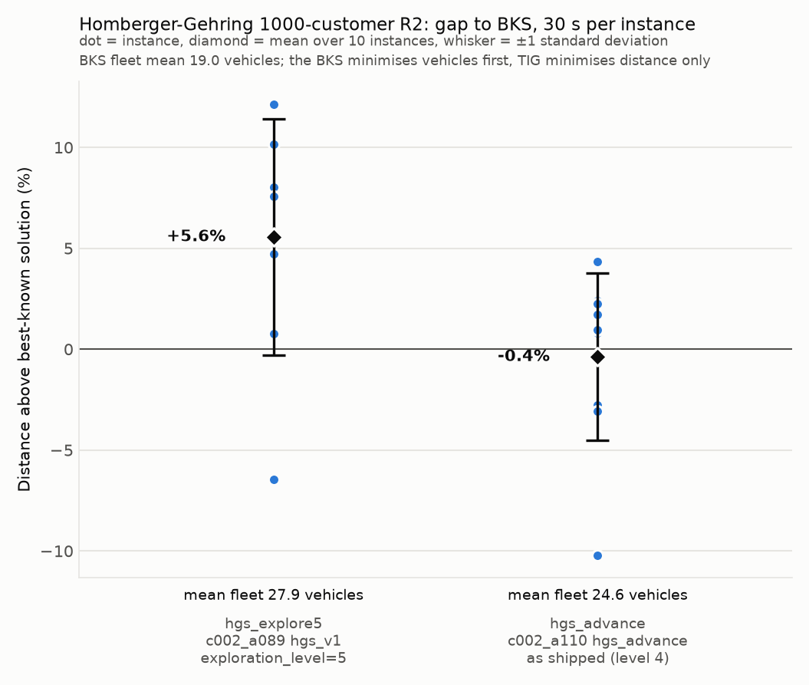

# Homberger-Gehring 1000-customer R2

Uniformly random customers, a long scheduling horizon, wide time windows and
vehicle capacity 1000: the best-known solutions use 19 vehicles with about 53
customers per route. Ten instances, `R2_10_1` to `R2_10_10`, from the SINTEF
1000-customer archive; the best-known values in `bks.json` are from the
SINTEF 1000-customer table, retrieved 2026-10-30.

The algorithms, budget, metric and caveats are shared across sets and
described in [the experiment README](../README.md).

## Results

| Instance | BKS vehicles | BKS distance | hgs_explore5 gap | hgs_explore5 vehicles | hgs_advance gap | hgs_advance vehicles |
|---|---|---|---|---|---|---|
| r2_10_1 | 19 | 42182.57 | -6.44%* | 39 | -10.20% | 33 |
| r2_10_2 | 19 | 33411.21 | +0.79%*† | 33 | -2.76%* | 27 |
| r2_10_3 | 19 | 24916.88 | +8.02%*† | 24 | +0.79%*† | 24 |
| r2_10_4 | 19 | 17851.96 | +12.11%*† | 22 | +2.42%*† | 20 |
| r2_10_5 | 19 | 36216.05 | +0.76%* | 37 | -3.05%* | 27 |
| r2_10_6 | 19 | 29978.02 | +5.74%*† | 25 | -0.31%* | 24 |
| r2_10_7 | 19 | 23219.61 | +10.14%*† | 23 | +2.26%*† | 23 |
| r2_10_8 | 19 | 17442.29 | +12.15%*† | 21 | +4.36%*† | 21 |
| r2_10_9 | 19 | 32995.71 | +4.73%*† | 30 | +0.96%† | 24 |
| r2_10_10 | 19 | 30207.49 | +7.58%*† | 25 | +1.72%*† | 23 |
| **mean ± sd** | **19.0** | | **+5.56% ± 5.85** | **27.9 ± 6.5** | **-0.38% ± 4.14** | **24.6 ± 3.7** |

`*` = stopped by the 30 s timeout; the last solution saved before the stop is the one
measured. `†` = at least one arrival after a due time under real-valued travel times
(`late_arrivals` and `max_lateness` in `results/per_instance.csv`).

`hgs_explore5` ran to the timeout on every instance; `hgs_advance` stopped on
its own criteria on two (mean solver time 29.3 s). Both use more vehicles
than the BKS on every instance, which is how `hgs_advance` lands below the
BKS distance on 4 of the 10 instances, by 10% on `r2_10_1` with 33 vehicles
against 19. The spread is the widest of the 1000-customer sets:
`hgs_explore5` ranges from 6% below to 12% above the BKS distance and its
fleet from 21 to 39 vehicles. Eight `hgs_explore5` and six `hgs_advance`
solutions have arrivals after a due time once travel times are real-valued,
by at most 0.9 time units on a horizon of about 7700.

`results/per_instance.csv` has every row, including TIG's integer objective
and the run status, and `results/summary.json` has the aggregates.
