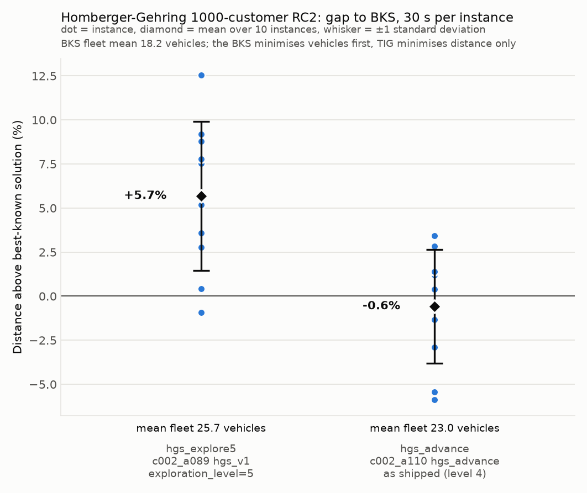

# Homberger-Gehring 1000-customer RC2

Mixed clustered and random customers, a long scheduling horizon, wide time
windows and vehicle capacity 1000: the best-known solutions use 18 to 20
vehicles with 50 or more customers per route. Ten instances, `RC2_10_1` to
`RC2_10_10`, from the SINTEF 1000-customer archive; the best-known values in
`bks.json` are from the SINTEF 1000-customer table, retrieved 2026-10-29.

The algorithms, budget, metric and caveats are shared across sets and
described in [the experiment README](../README.md).

## Results

| Instance | BKS vehicles | BKS distance | hgs_explore5 gap | hgs_explore5 vehicles | hgs_advance gap | hgs_advance vehicles |
|---|---|---|---|---|---|---|
| rc2_10_1 | 20 | 30276.27 | -0.91%*† | 34 | -5.86%† | 28 |
| rc2_10_2 | 18 | 26104.09 | +0.42%*† | 28 | -5.43%*† | 25 |
| rc2_10_3 | 18 | 19911.48 | +7.53%*† | 27 | +1.22%*† | 23 |
| rc2_10_4 | 18 | 15693.28 | +12.56%*† | 21 | +3.42%*† | 20 |
| rc2_10_5 | 18 | 27067.04 | +2.76%*† | 26 | -2.89%*† | 25 |
| rc2_10_6 | 18 | 26741.27 | +3.60%* | 26 | -1.32%† | 24 |
| rc2_10_7 | 18 | 24999.66 | +5.17%*† | 25 | +0.47%*† | 23 |
| rc2_10_8 | 18 | 23595.33 | +7.77%*† | 24 | +0.40%† | 21 |
| rc2_10_9 | 18 | 22919.42 | +8.78%*† | 23 | +1.39%*† | 21 |
| rc2_10_10 | 18 | 21834.94 | +9.19%*† | 23 | +2.85%* | 20 |
| **mean ± sd** | **18.2** | | **+5.69% ± 4.23** | **25.7 ± 3.6** | **-0.57% ± 3.23** | **23.0 ± 2.6** |

`*` = stopped by the 30 s timeout; the last solution saved before the stop is the one
measured. `†` = at least one arrival after a due time under real-valued travel times
(`late_arrivals` and `max_lateness` in `results/per_instance.csv`).

`hgs_explore5` ran to the timeout on every instance; `hgs_advance` stopped on
its own criteria on three (mean solver time 29.7 s). Both use more vehicles
than the BKS on every instance, which is how `hgs_advance` lands below the
BKS distance on 4 of the 10 instances. Nine of the ten solutions of each
configuration have a few arrivals after a due time once travel times are
real-valued, by at most 1.7 time units on a horizon of more than 7000.

`results/per_instance.csv` has every row, including TIG's integer objective
and the run status, and `results/summary.json` has the aggregates.
