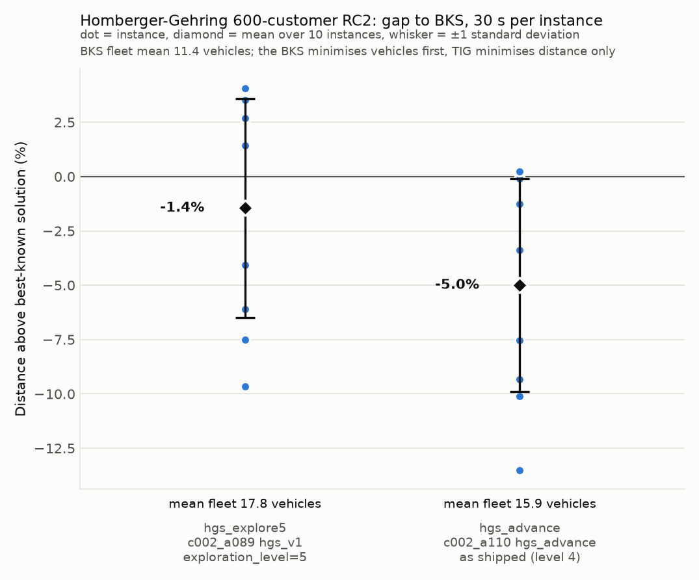

# Homberger-Gehring 600-customer RC2

The RC2 class at 600 customers, the smallest size in TIG's active
vehicle-routing tracks: mixed clustered and random customers, wide time
windows and vehicle capacity 1000, with best-known solutions of 11 to 14
vehicles and 43 or more customers per route. Ten instances, `RC2_6_1` to
`RC2_6_10`, from the SINTEF 600-customer archive; the best-known values in
`bks.json` are from the SINTEF 600-customer table, retrieved 2026-10-30.

The algorithms, budget, metric and caveats are shared across sets and
described in [the experiment README](../README.md).

## Results

| Instance | BKS vehicles | BKS distance | hgs_explore5 gap | hgs_explore5 vehicles | hgs_advance gap | hgs_advance vehicles |
|---|---|---|---|---|---|---|
| rc2_6_1 | 14 | 13324.93 | -7.50%*† | 25 | -9.32%† | 22 |
| rc2_6_2 | 12 | 11555.51 | -6.09%* | 20 | -10.11%† | 19 |
| rc2_6_3 | 11 | 9438.52 | -1.46%*† | 18 | -5.04% | 16 |
| rc2_6_4 | 11 | 7057.94 | +4.07%*† | 13 | +0.03%† | 12 |
| rc2_6_5 | 11 | 12909.07 | -9.66%*† | 21 | -13.50%† | 19 |
| rc2_6_6 | 11 | 11913.11 | -4.05%*† | 17 | -7.54%† | 17 |
| rc2_6_7 | 11 | 10711.85 | +1.43%*† | 18 | -3.37%† | 15 |
| rc2_6_8 | 11 | 9990.40 | +2.59%* | 16 | -1.27%† | 14 |
| rc2_6_9 | 11 | 9574.99 | +3.51%* | 17 | -0.10% | 13 |
| rc2_6_10 | 11 | 9058.90 | +2.67%* | 13 | +0.22% | 12 |
| **mean ± sd** | **11.4** | | **-1.45% ± 5.04** | **17.8 ± 3.6** | **-5.00% ± 4.91** | **15.9 ± 3.3** |

`*` = stopped by the 30 s timeout; the last solution saved before the stop is the one
measured. `†` = at least one arrival after a due time under real-valued travel times
(`late_arrivals` and `max_lateness` in `results/per_instance.csv`).

At 600 customers `hgs_advance` stopped on its own criteria on every instance
(mean solver time 23.3 s) and lands below the BKS distance on 8 of the 10, by
up to 13.5%; `hgs_explore5` ran to the timeout on every instance and is below
on 5. Both use more vehicles than the BKS on every instance, 16 and 18 on
average against 11.4, and the largest distance gains come with the largest
fleets (`rc2_6_1`, `rc2_6_2`, `rc2_6_5`). Six `hgs_explore5` and seven
`hgs_advance` solutions have arrivals after a due time once travel times are
real-valued, by at most 2.0 time units on a horizon of 4823.

`results/per_instance.csv` has every row, including TIG's integer objective
and the run status, and `results/summary.json` has the aggregates.
